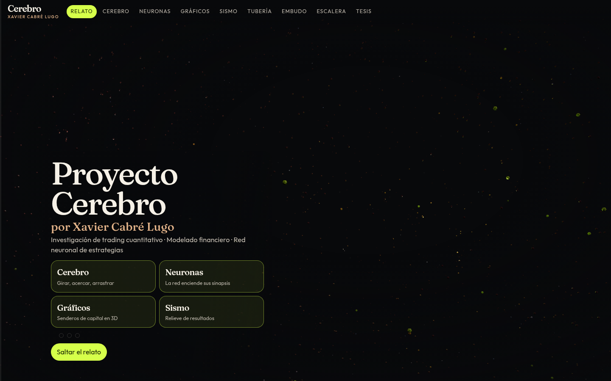
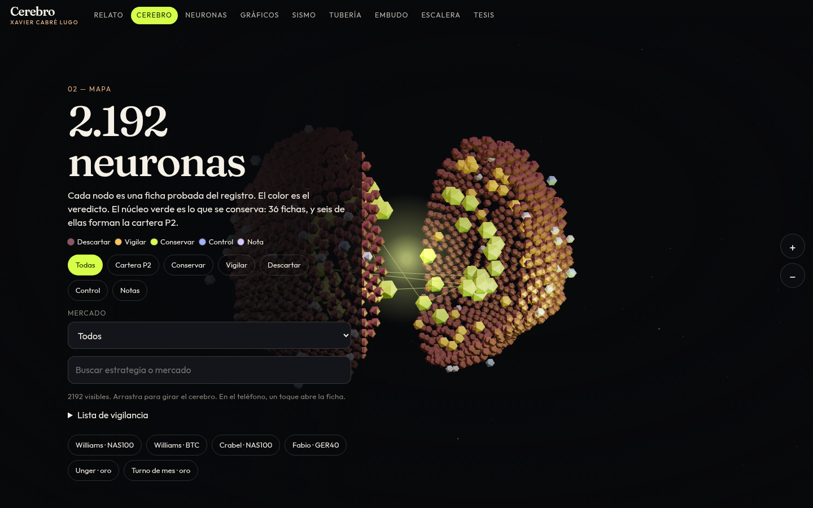
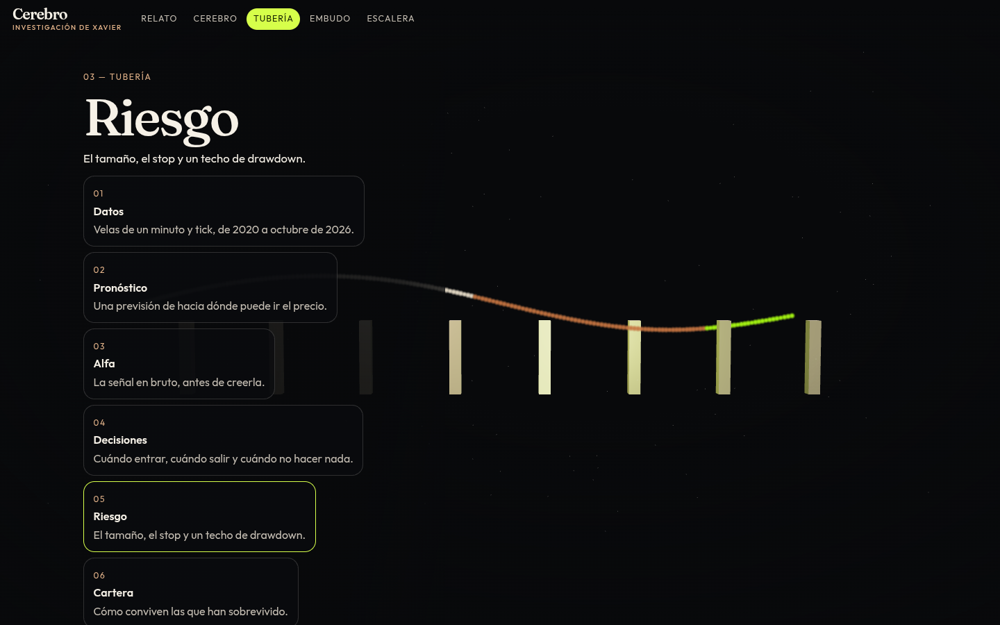
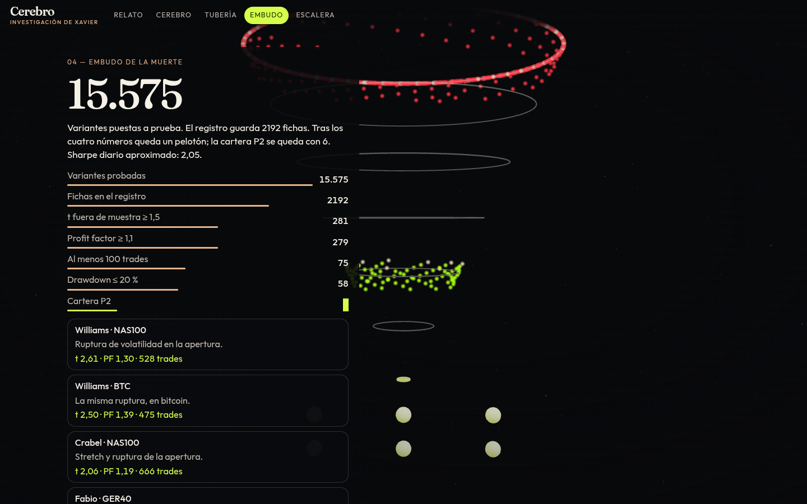
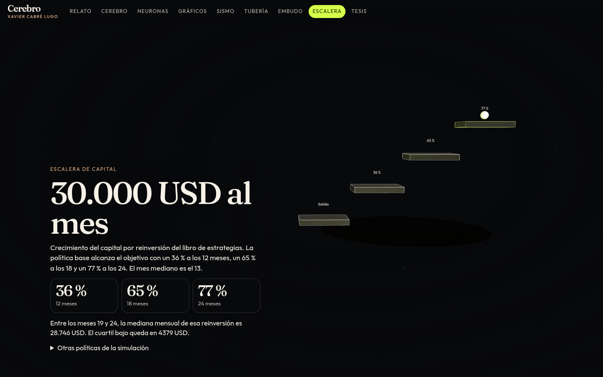
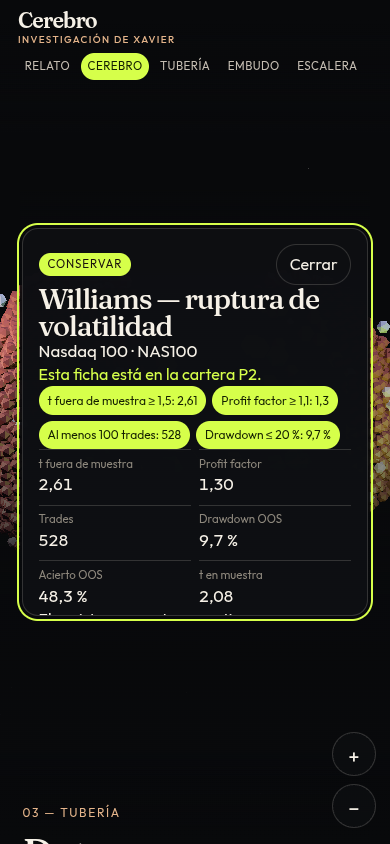

# Cerebro

Sitio estático, en español, del Proyecto Cerebro de Xavier Cabré Lugo. Un cerebro en 3D con una neurona por ficha del registro, la tubería de la investigación, el embudo desde 15.575 variantes hasta las 6 de la cartera P2, la escalera de capital hacia 30.000 USD al mes y las tesis que alimentan las neuronas.

## De dónde salen los números

| Archivo | Qué aporta |
| --- | --- |
| `data/raw/strategy_registry.csv` | Cada ficha probada: mercado, veredicto, t, profit factor, trades, drawdown y motivo. |
| `data/raw/ladder22.csv` y `ladder23.csv` | Probabilidades a 12, 18 y 24 meses, mes mediano y resultado mensual de la reinversión. |
| `data/raw/RESUMEN.md` | El relato: 15.575 pruebas, 25 tandas, Sharpe de P2, regla de descarte y el objetivo de 30.000 USD. |
| `data/tesis/` | Papers, tesis y teorías de oficio. `npm run data` las compacta en `src/generated/tesis.json`. |

`npm run data` (también corre antes de `dev` y `build`) compacta eso en `src/generated/research.json`. El embudo de t, profit factor, trades y drawdown se cuenta desde el registro. Si el resumen y las escaleras no cuadran, el script se detiene.

## Arrancar

```bash
npm install
npm run dev
```

Abre la URL que imprime Vite. En el teléfono, el cerebro se gira con el dedo y se toca una neurona para ver la ficha. El menú superior cambia de escena cuando el lienzo captura el gesto.

## Compilar

```bash
npm run build
npm run preview
```

La salida queda en `dist/`. La base de Vite es relativa (`./`), así que el mismo build sirve en la raíz de un dominio y en un sitio de proyecto de GitHub Pages.

## GitHub Pages

El workflow `.github/workflows/pages.yml` publica `dist/` en cada push a `main`. En el repositorio: Settings → Pages → Build and deployment → Source: GitHub Actions. La URL queda en `https://<usuario>.github.io/cerebro-trading-3d/`.

## Vercel

Importa el repositorio. `vercel.json` ya marca Vite, `npm ci`, `npm run build` y la carpeta `dist`. No hace falta cambiar el directorio de salida.

## Qué se ve

1. **Relato.** Cuatro tramos al hacer scroll.
2. **Cerebro.** 2.192 nodos coloreados por veredicto. Al elegir uno: mercado, t fuera de muestra, profit factor, trades, drawdown y motivo.
3. **Tubería.** Datos → pronóstico → alfa → decisiones → riesgo → cartera → prueba → ejecución, con partículas.
4. **Embudo.** 15.575 variantes, los filtros del registro y las 6 supervivientes P2. Debajo, los descartes famosos.
5. **Cerebro, Neuronas, Gráficos y Sismo.** El cerebro se gira y se acerca. Neuronas enciende las sinapsis. Gráficos dibuja una simulación ilustrativa de senderos. Sismo levanta el t fuera de muestra por mercado y tanda.
6. **Escalera de capital.** 36 % / 65 % / 77 % a 12 / 18 / 24 meses, la mediana mensual de la reinversión y el cuartil bajo.
7. **Tesis.** Cada paper o teoría, con autores y, si el archivo los trae, año e institución, y las neuronas que alimenta.

En pantallas estrechas baja la resolución del lienzo y el número de partículas. `prefers-reduced-motion` deja las escenas quietas.

## Capturas

| Relato | Cerebro |
| --- | --- |
|  |  |

| Tubería | Embudo |
| --- | --- |
|  |  |

| Escalera | Teléfono |
| --- | --- |
|  |  |
